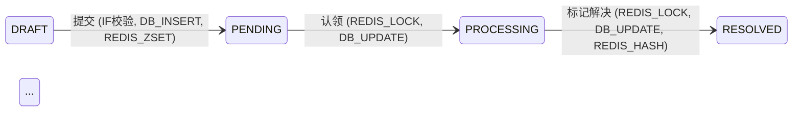

# 需求分析技能（Request Analysis）

## 概述

将 `doc/request/` 下的原始需求文档转化为**单文件结构化分析报告（人机共读摘要）**，写入 `.harness/requests/{需求名}/summary.md`。同时自动提取并生成对应的 SQL DDL 到 `sql/` 目录。

核心原则：**一个需求一份报告，章节与图表工具按"逻辑型态"自适应展开。严禁格式教条化——简单CRUD绝不硬画状态机，但复杂逻辑必须由 AI 精准匹配工具（表格/时序图/状态图），确保细节足够支撑下游 coding-agent 闭眼执行。**

## 触发条件

- "分析需求文档" / "解析这个 PRD"
- 用户给出需求文字描述
- 指定 `doc/request/` 下的文档
- "整改需求" / "按 findings 整改" → 进入**接单模式**（见执行步骤 §0）

## 执行步骤

### §0 任务模式判定（第一步，不可跳过）

| 模式 | 判定依据 | 入口 |
|------|---------|------|
| **新建模式** | 输入为 doc/request/ 下的原始需求 | 从 Step 0 意图置信度评估开始 |
| **接单模式（整改）** | 用户指定 `.harness/requests/{需求名}/_review/review-findings.md`，或该文件存在且用户意图为整改 | **跳到 Step 5.3**，禁止重走 Step 0-4 |

> 🔴 接单模式**不依赖原 session 上下文**：summary.md + alignment-log.md + review-findings.md 即完整工作现场，
> 新 session 凭 `.harness/requests/{需求名}/` 目录接管。原始 PRD（doc/request/）仅作溯源参考。
> 🔴 接单模式加载顺序：review-findings.md → summary.md → alignment-log.md →（必要时）原始 PRD。

### Step 0: 意图置信度评估

读取需求文档后，在进行任何型态判定和文件生成之前，必须先评估需求的意图置信度，并输出对应状态。

**判定标准：**
- 🟢 **绿灯**：业务流程闭环，输入输出明确，无核心逻辑断层，无致命依赖缺失。
- 🟡 **黄灯**：存在局部歧义或不影响主流程的盲区，**不可自行假设推进**，必须进入意图对齐。
- 🔴 **红灯**：存在核心逻辑断层（如只有成功没有失败流）、前后矛盾、或缺失关键数据源/接口文档。**核心主流程的关键规则只有结论没有机制的，视同核心逻辑断层**——如"防重复"无服务端方案、"按最高展示"无计算口径、"看情况跳转"无分支条件、"仅本人可见"无所属人校验。

**动作执行矩阵：**
- **🟢 绿灯**：直接进入 Step 1 继续执行。
- **🟡 黄灯**：进入 Step 0.5 意图对齐，逐个消除歧义点。
- **🔴 红灯**：进入 Step 0.5 意图对齐，优先消除核心逻辑断层。**🔴 歧义点未全部消除前，报告 `status` 必须为 `blocked`，且 §3.10 任务拆分的首任务强制为 `[BLOCKER] 消除核心逻辑断层：{断层描述}`，禁止下游 coding-agent 开工。**

> **关键：红黄灯不是终止，是"必须对齐"的信号。** 对齐完成后重新评估，直到绿灯才进入 Step 1。

### Step 0.5: 意图对齐（迭代循环）

**执行位置：必须在主Agent层执行。** subAgent无法中途与人类交互，意图对齐必须在主Agent对话中完成。

**核心流程：**

```
AI分析需求 → 在状态图/时序图/决策表上标记所有🟡/🔴歧义点
  → 逐个精准提问（描述gap + 选项1/2/3/4+其他）
  → 人类选择或输入
  → AI注入意图，补全图，不重启，继续分析
  → 重新评估置信度
  → 🟢 进入 Step 1
  → 仍有🟡/🔴 → 继续 Step 0.5
```

**歧义点发现规则：**

AI在以下位置发现未定义、未覆盖、未明确的信息时，必须标记为歧义点：

| 载体 | 歧义点类型 | 示例 |
|------|-----------|------|
| 状态图 | 未定义的状态转移目标 | "部分退款后订单状态是什么？" |
| 状态图 | 缺失的异常/回滚路径 | "支付退款失败后状态回退到哪？" |
| 时序图 | 未覆盖的异常分支 | "第三方接口超时怎么处理？" |
| 时序图 | 缺失的补偿/回滚逻辑 | "库存释放失败如何补偿？" |
| 决策表 | 缺失的条件组合 | "VIP+余额不足+有优惠券怎么处理？" |
| 数据模型 | 字段语义歧义 | "status=2 是审核中还是已驳回？" |
| 接口依赖 | 第三方接口契约不明 | "短信网关的限频规则是什么？" |
| 写入安全 | 写操作的服务端防重/越权未显式说明 | "提交只说了前端置灰，服务端怎么防重复提交？" / "接口要不要校验资源所属人？" |
| 术语对齐 | 实体/字段命名与 wiki/领域术语 不一致的新造词 | "PRD 说'订单编号'，领域术语是 orderNo，用哪个？" |

**精准提问格式（严格遵守）：**

```
🟡 意图对齐：{具体gap描述，引用图上的位置}

  1. {选项1：具体描述，包含状态/动作/结果}
  2. {选项2：具体描述}
  3. {选项3：具体描述}
  4. 其他（请输入）

请选择 [1/2/3/4]：
```

**提问规则：**
- 每个歧义点**必须**给出至少3个结构化选项，选项之间互斥且覆盖主要可能性
- **必须**包含"4. 其他（请输入）"，允许人类给出选项外的意图
- 选项描述**必须具体**——包含状态值、动作、结果，禁止模糊描述如"正常处理"
- 一次提问**只针对一个歧义点**，不要把多个gap混在一个问题里
- 歧义点按**影响范围排序**：影响主流程的优先问，边界case后问

**人类回答后的处理：**
- 人类选择选项N → AI将选项N的语义注入对应图的位置，补全转移/分支/条件
- 人类选择"4. 其他"并输入文本 → AI理解文本语义，注入对应位置
- **不重启Agent，不丢失上下文**，在当前分析中继续
- 每个对齐结果**立即反映到图上**，下一个歧义点的提问基于已补全的图
- 🔴 **实时记录对齐流水**：每轮问答后追加 `.harness/requests/{需求名}/_review/alignment-log.md`，格式：

```
## Q{n} {歧义点一句话}（{时间}）
- 提问：{给人类的选项摘要}
- 人类原话：{一字不改的回答}
- 注入解读：{AI 注入到图/规则的语义}
- 落点：{状态机边/时序图步骤/决策表规则号/字段}
```

**迭代终止条件：**
- 所有🟡/🔴歧义点已消除
- 重新评估意图置信度 = 🟢
- 或人类明确表示"剩余盲区可以后续处理"（此时未消除的歧义点降级为`[🟡待澄清]`归入人类待办，但**仅限不影响主流程的边界case**）
- 🔴 **降级确认回执**：任何降级为`[🟡待澄清]`的歧义点，**必须**先向人类逐条出示并获得明确同意；报告中每个降级项附人类确认记录。**未经确认的自行降级视为意图对齐未完成**，报告 frontmatter 禁止标 `intent_aligned: true`

**禁止：**
- 🔴 禁止在意图不明确时自行假设并继续（"合理的技术假设"不等于意图对齐）
- 🔴 禁止用开放式问题替代结构化选项（"你觉得呢"不是精准提问）
- 🔴 禁止省略"4. 其他"选项
- 🔴 禁止在核心主流程的歧义点上降级为`[🟡待澄清]`跳过——核心主流程必须当场对齐
- 🔴 禁止把多个歧义点合并为一个问题
- 🔴 禁止中途另开新 session 或丢弃已注入的意图上下文——同 session 内的多轮问答回合是标准流程，必须在原会话上下文内连续完成

> 🟡 平台支持结构化提问工具时（如 Claude Code 的 AskUserQuestion）优先使用；文本多轮问答是默认标准流程，必须严守上述精准提问格式。UI 形式可选，格式与"不丢上下文"是底线。

### Step 1: 判定逻辑型态与复杂度（技术选型）

读取需求文档后，首先识别该需求的**核心逻辑特征（可多选）**，并据此决定产出的图表工具。型态判定结果必须写入报告的 Frontmatter 元数据中：

```
【型态判定标准】
1. 状态驱动型 (State-Driven)：存在核心实体（单据/工单/订单）明显的生命周期跳转
   （如：草稿→待审→处理中）。
2. 流程驱动型 (Process-Driven)：涉及多接口串联、跨服务调用、或长链路的技术动作、
   分布式事务传递（如：调三方→插DB→存Redis）。
3. 规则驱动型 (Rule-Driven)：包含密集的业务判断分支、权限校验组合、计费公式
   （大量的 if-else 嵌套）。
```

根据型态与复杂度，动态路由生成工具矩阵（写入 summary.md 头部）：

| 识别型态 | 匹配工具与章节 | 触发门槛 |
|----------|--------------|---------|
| **State-Driven** | `stateDiagram-v2` (状态图) | 状态数 ≥ 4 时必须生成 |
| **Process-Driven** | `sequenceDiagram` (时序图) | 跨系统/接口/组件调用 ≥ 3 个时必须生成 |
| **Rule-Driven** | `Decision Table` (条件决策矩阵表) | 条件组合分支 ≥ 3 种时必须生成 |

**复杂度判定（写入 Frontmatter `complexity` 字段）：**

- **simple**：纯单表 CRUD，无上述任何型态特征。
- **medium**：仅命中单一种型态，且逻辑链路较短、未达到该型态的触发门槛。
- **complex**：同时命中 2 种及以上型态，或任意一型态达到触发门槛。

> **降级修正（防过度设计）**：同时命中 2 种以上型态，但每种型态都明确低于其触发门槛（如：3 状态的 State-Driven + 2 分支的 Rule-Driven），降级为 medium。理由：低强度多型态的组合复杂度仍可由 medium 章节覆盖，不必激活全套图表工具。

### Step 2: 提取数据模型，生成 SQL

无论需求何种复杂度，数据模型是强制必须输出的。

1. 解析需求，在 summary.md 的「数据模型」章节中列出实体、字段清单和索引建议。
2. **在「数据模型」章节顶部，必须显式登记生成的 SQL 文件相对路径。**
3. 同步生成 SQL DDL 脚本 → 写入 `sql/{表名}.sql`，文件头强制标注 `-- generated by doc-analysis, pending_review`。

### Step 3: 逐章节自适应填充

按 Step 1 路由的结果，严谨填充以下结构化章节：

**3.1 Frontmatter（元数据配置）**

```yaml
---
complexity: complex | medium | simple
logic_pattern: [State-Driven, Process-Driven, Rule-Driven]
selected_tools: [stateDiagram-v2, sequenceDiagram, decision_table]
---
```

**3.2 需求概述**（所有复杂度必填）

- **一句话定位**：说明本业务的核心商业目标。
- **角色职责**：哪些角色可操作，有什么权限限制。
- **验收标准 (AC) 清单**：可量化的测试/交付边界。

**3.2.1 意图注入映射表**（经历 Step 0.5 后必填）

每条人类注入的意图一行，形成"注入 → 落点"回执，禁止只注入不落地：

| # | 注入的意图 | 落点（状态图边/时序图步骤/决策表规则号/字段/Redis Key） |
|---|-----------|------------------------------------------------------|

- 落点必须精确到图上的边、步骤编号、规则编号或字段名，禁止写"已体现在流程中"这类虚词
- 🔴 **落点锚点禁止凭空手写**：先用 `python .harness/tools/alignment_mapper.py .harness/requests/{需求名}/summary.md`
  生成 `_review/mapping-draft.md` 草稿（脚本真实定位章节号/规则号/步骤号），在其基础上补审语义列。
  手写锚点是错位事故的首要来源（lint L4 会复核）
- 任何一条注入意图找不到落点 → 视为未消化，**必须当场回问人类**，不得静默丢弃
- 降级为`[🟡待澄清]`的条目也在本表登记，并附人类确认记录（见 Step 0.5 降级确认回执）

**3.3 模块影响**（所有复杂度必填）

- 受影响的领域模块、应用服务类、基础设施类或核心表，并注明原因。
- 按 COLA 四层标注影响范围：`interfaces` / `application` / `domain` / `infrastructure`。

**3.4 数据模型**（所有复杂度必填）

- 关联 DDL 文件路径：`sql/{表名}.sql`
- 实体-字段物理结构说明、索引设计理由。

**3.5 核心状态机**（仅在激活 stateDiagram-v2 时填充）

- **Mermaid 规范**：必须声明 `direction LR`。每条流转边（Transitions）上**必须**使用冒号 `:` 附加底层技术动作打标，格式为：`触发动作 (技术动作1, 技术动作2)`。
- *示例：`DRAFT --> PENDING: 提交 (IF校验, DB_INSERT, REDIS_ZSET)`*

**3.6 核心业务流程**（仅在激活 sequenceDiagram 时填充）

- **Mermaid 规范**：必须开启 `autonumber`（人机共读，便于人类审批时定位步骤）。必须声明 `participant` 区分内部组件（Service, DB, Redis）与外部第三方系统（API）。
- 箭头交互文本中，必须用括号 `()` 标注核心传递的数据变量，严禁只有空洞的文字线条。

**3.7 业务决策规则**（仅在激活 decision_table 时填充）

- **规范**：严禁画线段交织的流程图。必须使用标准的 **Markdown 条件-动作矩阵表**。
- *列格式：`| 规则编号 | 条件: 变量A | 条件: 变量B | 动作: 执行逻辑 | 动作: 异常分支 |`*

**3.8 Redis / 缓存场景**（如有触发必填）

- 场景描述（问题 → 锁/缓存规则 → 兜底思路）
- Key 命名与 TTL（生存时间）设计。

**3.9 红线检查**（所有复杂度必填）

- 对照项目底线红线逐条检查。
- 如果存在严重冲突，必须用 `🔴 [CRITICAL_CONFLICT]` 醒目标注。

**3.10 任务拆分（Task Breakdown）**

- 按开发、依赖顺序排列的子任务列表，单个子任务工时估算建议 ≤ 4h。

### Step 4: 写入文件与副作用隔离

```
最终输出文件结构:
  ├── .harness/requests/{需求名}/summary.md   ← 单文件结构化分析报告
  └── sql/{表名}.sql                          ← 自动生成的 DDL（支持多个）
```

*注：覆盖同名目录前，必须在终端提示人类用户确认。*

### Step 5: 蓝军评审交接（complex 需求强制）

> 本 agent **不执行评审、不调度评审**。评审由独立 session 的 requirement-review-agent（蓝军）完成，
> 调度归元 Agent/人类/自动化层。本 agent 的职责是**开单、停手、接单**。

**5.1 开单（报告完成后立即执行）**

complex 需求的 summary.md 落盘后，必须：

0. 🔴 **先跑机械自检**：`python .harness/tools/summary_lint.py .harness/requests/{需求名}/summary.md`，
   lint 报告随产物一并落入 `_review/lint-report.md`。
   **CRITICAL 未归零不得开单**——机械错误（锚点错位/无成功终态/表无人写入）必须当场修正，
   不得把 lint 能抓的问题留给蓝军（蓝军的精力留给语义判断）。
1. 生成 `.harness/requests/{需求名}/_review/review-request.md`：

```markdown
---
feature: {需求名}
complexity: complex
status: pending_review
created: YYYY-MM-DD
---

# 蓝军评审请求 — {需求名}

## 产物清单
- summary.md（报告）
- sql/{表名}.sql × N
- _review/alignment-log.md（意图对齐流水，共 N 轮问答）

## 红军自评
{一段话：型态判定、红灯消除情况、降级项数量}

## 建议评审重点
{本需求中红军认为风险最高的 2-3 处}
```

2. 确认 summary.md frontmatter `status: pending_review`，并向人类声明：
   **"complex 需求，待蓝军评审。未过审（PASS）前 status 不得流转为 approved，下游 coding-agent 不得开工。"**
   同时给出蓝军启动提示词：`评审 .harness/requests/{需求名}/ 的需求分析产物`

**5.2 停手**

开单后本 agent 任务结束。simple/medium 需求无需开单，报告可直接进入 `pending_review` 人工抽检。

**5.3 接单（发现 `_review/review-findings.md` 时）**

1. 逐条整改 findings（CRITICAL/MAJOR 必须处理，MINOR 可登记随编码阶段修）
2. 整改过程追加 `.harness/requests/{需求名}/_review/revision-log.md`（每条 findings → 处理动作 → 落点）
3. 🔴 **整改后必须重跑 lint**：`python .harness/tools/summary_lint.py .harness/requests/{需求名}/summary.md`，
   **CRITICAL 归零**才可交付第 2 轮评审；lint-report.md 同步更新
4. verdict = PASS → `status` 转 `approved`；FAIL-可整改 → 整改后等待第 2 轮评审（最多 2 轮）；FAIL-重做 → 报告作废重走 Step 0
5. 🔴 蓝军 findings 与已注入意图冲突时，**不得自行二选一**，必须向人类出示冲突点请其裁决

## 约束（Constraints）

1. 🔴 **红线阻断机制**：若 `3.9 红线检查` 中识别出 🔴 冲突，`3.10 任务拆分` 的第一个任务**必须强制固定**为 `[BLOCKER] 解决红线冲突：{冲突描述}`。以此作为中断信号，阻断下游 Coding-Agent 盲目开工。
2. 🔴 **拒绝图表混淆**：严格执行工具路由。线性调用和跨系统时序**禁止**使用状态图（`stateDiagram-v2`）；复杂条件分支**禁止**使用流程图（`graph TD`），必须使用决策表。
3. 🔴 **技术打标强校验**：在 complex 场景下，Mermaid 状态图每条边上的技术动作（如 `DB_INSERT`, `REDIS_LOCK`）为**强制必填项**，严禁只写含糊的纯业务中文。
4. 🔴 **路径隔离**：SQL 必须生成到项目根目录的 `sql/` 文件夹下，严禁污染 `.harness/` 配置目录。
5. 🔴 **意图对齐强制**：黄灯盲区**禁止自行假设推进**，必须走 Step 0.5 意图对齐。核心主流程的歧义点必须当场对齐，不可降级为`[🟡待澄清]`跳过。仅不影响主流程的边界case允许降级标记。
6. 🔴 **意图对齐执行层**：Step 0.5 必须在主Agent层执行。subAgent发现意图gap时，只能标记BLOCKED写回，由主Agent处理。
7. 🔴 **不修改 specs/ 和 wiki/**（那是元 Agent 和文档园丁的辖区）
8. 🔴 **不生成代码**（只生成需求分析报告）
9. 🟡 可建议 specs/ 需要更新
10. 🟡 可建议 wiki/ 需要更新
11. 🔴 **降级确认回执**：`[🟡待澄清]` 降级必须逐条经人类确认并在报告中附确认记录；未经确认的自行降级 = 意图对齐未完成，禁止标 `intent_aligned: true`（同 Step 0.5 迭代终止条件）
12. 🔴 **意图注入映射表**：报告必须包含 §3.2.1 映射表，每条注入意图有精确落点；找不到落点的意图必须回问，禁止静默丢弃
13. 🔴 **术语对齐**：实体/字段/接口命名必须优先采用 wiki/领域术语 中的既有术语；确需新造词的，作为歧义点走 Step 0.5 提问确认
14. 🔴 **红灯阻断机制**：存在未消除的 🔴 歧义点时，报告 `status` 必须为 `blocked`，§3.10 首任务强制为 `[BLOCKER] 消除核心逻辑断层：{断层描述}`；🔴 全部消除前禁止下游 coding-agent 开工

---

## 产出示例

以下是一个复杂需求（State-Driven + Process-Driven + Rule-Driven 同时命中）的 summary.md 目录级概览：

```markdown
---
complexity: complex
logic_pattern: [State-Driven, Process-Driven, Rule-Driven]
selected_tools: [stateDiagram-v2, sequenceDiagram, decision_table]
feature: 工单管理系统
source: doc/request/workorder.md
status: pending_review
generated_by: doc-analysis
intent_aligned: true
---

# 工单管理系统 — 需求分析

## 1. 需求概述
（一句话定位 + 角色职责表 + AC 清单）

## 2. 模块影响
（受影响领域模块及 COLA 四层范围）

## 3. 数据模型
> DDL: sql/work_order.sql, sql/work_order_comment.sql, sql/work_order_sla.sql

| 实体 | 字段 | 类型 | 说明 |
|------|------|------|------|
| 工单 | ... | ... | ... |

## 4. 核心状态机



## 5. 核心业务流程

```mermaid
sequenceDiagram
    autonumber
    participant U as 申请人
    participant S as Service
    participant R as Redis
    participant D as MySQL
    U->>S: 提交工单 ( title, category )
    S->>R: 获取编号 ( INCR wo:seq:20260616 )
    S->>D: INSERT 工单 ( order_no, status=0 )
    ...
```

## 6. 业务决策规则

| 规则 | 条件: 当前状态 | 条件: 操作人 | 动作: 执行 | 动作: 异常 |
|------|-------------|------------|-----------|----------|
| BR-01 | 草稿 | — | 校验通过→待处理 | 提示必填项 |
| BR-02 | 待处理 | — | 加锁→UPDATE→处理中 | 提示已被认领 |
| ... |

## 7. Redis / 缓存场景
（Key 设计 + TTL + 业务规则 + 兜底思路）

## 8. 红线检查
（逐条对照 + 🔴 冲突标注）

## 9. 任务拆分
| # | 任务 | 估时 | 依赖 |
|---|------|:---:|:---:|
| 1 | DDL 执行 | 0.5h | — |
| 2 | 领域实体 + Repository | 2h | 1 |
| ... |
```

---

## 意图对齐示例

以下展示 Step 0.5 意图对齐的典型交互过程：

```
AI: 🟡 意图对齐：状态图中"退款"转移的目标状态未定义

  1. 退款后状态变为REFUNDING，等支付退款成功后变为REFUNDED
  2. 退款后状态直接变为REFUNDED，支付退款异步处理
  3. 退款后状态不变，创建独立的退款单跟踪退款流程
  4. 其他（请输入）

请选择 [1/2/3/4]：

用户: 1

AI: 已注入：退款 → REFUNDING (REDIS_LOCK, PAYMENT_REFUND)
    继续分析...

AI: 🟡 意图对齐：时序图中 paymentService.refund() 失败后的处理路径未定义

  1. 订单状态回退到原状态，记录退款失败日志，归入人工待办
  2. 自动重试3次（间隔5s），仍失败则状态标记REFUND_FAILED，触发告警
  3. 订单状态保持REFUNDING，创建运维工单人工处理
  4. 其他（请输入）

请选择 [1/2/3/4]：

用户: 2

AI: 已注入：paymentService.refund() 失败 → 重试3次 → REFUND_FAILED + 告警
    继续分析...

AI: 🟡 意图对齐：决策表中"普通用户 + 余额不足 + 有优惠券"条件组合的处理策略未定义

  1. 拒绝下单，提示余额不足（忽略优惠券）
  2. 允许下单，使用优惠券抵扣部分金额，剩余金额仍不足则拒绝
  3. 允许下单，走混合支付（余额+优惠券+补差）
  4. 其他（请输入）

请选择 [1/2/3/4]：

用户: 4  余额不足时一律拒绝，不区分是否有优惠券

AI: 已注入：余额不足 → 拒绝（不区分优惠券状态）
    继续分析...

AI: 意图置信度评估：🟢 绿灯，所有歧义点已消除。进入 Step 1 型态判定。
```
